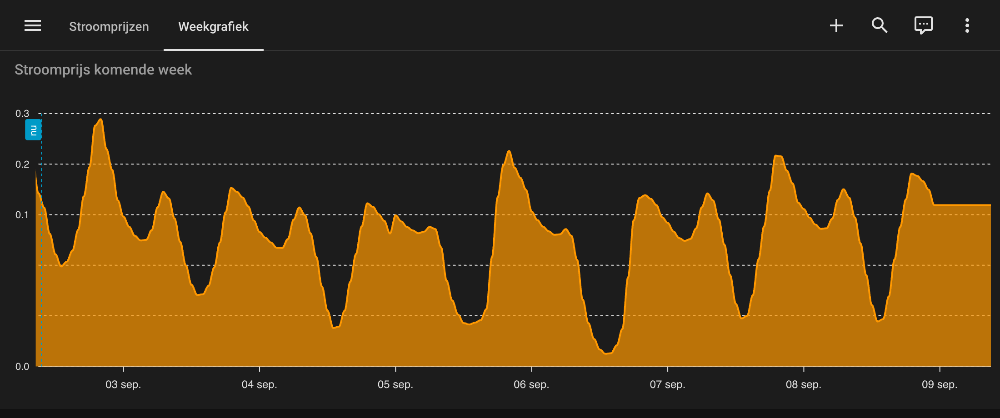
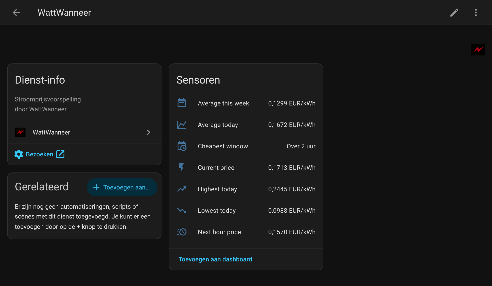
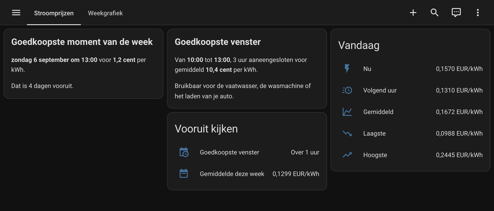

# WattWanneer voor Home Assistant

[](https://github.com/hercozandwijk/wattwanneer-homeassistant/actions/workflows/validate.yml)
[](https://hacs.xyz)

Zet de Nederlandse stroomprijzen van [WattWanneer](https://wattwanneer.nl) in Home
Assistant, inclusief de voorspelling tot zeven dagen vooruit. Waar day-ahead-bronnen
stoppen bij morgen, kun je hiermee kiezen welke dag van de week het goedkoopst is.



*De voorspelling voor zeven dagen, getekend met ApexCharts. Het dal op zondag is
het goedkoopste moment van de week, vier dagen voordat een day-ahead-bron het ziet.*

## Wat je krijgt

| Sensor | Wat het is |
| --- | --- |
| Huidige prijs | Prijs van het lopende uur |
| Prijs volgend uur | Handig voor automations die net iets vooruit kijken |
| Gemiddelde vandaag | Referentie om "goedkoop" tegen af te zetten |
| Laagste vandaag | Met het uur als attribuut |
| Hoogste vandaag | Met het uur als attribuut |
| Goedkoopste venster | Starttijd van het goedkoopste aaneengesloten blok in de dagreeks, zie de waarschuwing onder deze tabel |
| Gemiddelde deze week | Met de volledige 168-uurs reeks plus het goedkoopste uur van de week als attribuut |
| Prijzen (Nordpool-formaat) | Huidige prijs met `raw_today`, `raw_tomorrow` en `tomorrow_valid` zoals de Nordpool-integratie, voor pakketten die een Nordpool-sensor vragen |

De sensoren `Huidige prijs` en `Gemiddelde deze week` hebben de volledige
prijsreeksen als attributen, zodat je ze direct in ApexCharts of een eigen
template kunt gebruiken.



**Let op bij Goedkoopste venster.** Die sensor komt uit `/v1/summary`, dat rekent
over de eerste 24 punten van de voorspelling. De reeks begint bij middernacht van
de dag waarop de voorspelling is gedraaid, en de dagelijkse run is rond 13:30.
Kijk je daarvoor, dan kan het venster al achter je liggen. In de zomer valt dat
nauwelijks op omdat de zon het goedkoopste blok naar de middag duwt, maar in
januari 2026 lag het op 29 van de 31 dagen al voor 12:00. Bouw je er een
automation op, vang dat geval dan af of gebruik `/v1/charge-plan`, want dat
endpoint laat uren die al voorbij zijn weg.

De entity-ids zijn Engels, ook als je Home Assistant in het Nederlands draait.
Home Assistant leidt een entity-id altijd af van de Engelse naam, dus de sensor
die je in de interface ziet als `Gemiddelde deze week` heet intern
`sensor.wattwanneer_average_this_week`.

## Installatie

1. Voeg deze repository in HACS toe als custom repository (categorie: Integration).
2. Installeer WattWanneer en herstart Home Assistant.
3. Ga naar Instellingen, Apparaten en diensten, Integratie toevoegen, en zoek WattWanneer.
4. Vul je API-key in.

Nog geen API-key? Je sluit een abonnement af op
[wattwanneer.nl/api.html](https://wattwanneer.nl/api.html).

Wordt je key later geweigerd, bijvoorbeeld omdat je abonnement is verlopen of
opnieuw is afgesloten, dan vraagt Home Assistant zelf om een nieuwe key. Je
sensoren en hun historie blijven gewoon bestaan.

## Hoe vaak wordt er opgehaald

Eén keer per uur. De voorspelling zelf ververst één keer per dag, in de middag,
dus vaker ophalen levert dezelfde data op. De API staat 10 verzoeken per minuut
toe, dus je zit hier ruim onder.

## Als Nordpool-sensor, bijvoorbeeld voor een Zendure-batterij

Veel pakketten voor Home Assistant lezen hun prijzen uit een sensor van de
Nordpool-integratie. De sensor `sensor.wattwanneer_prices_nordpool_format` heeft
dezelfde attributen, dus je vult daar WattWanneer in:

- `raw_today` en `raw_tomorrow`: per uur `start`, `end` en `value`, met
  datetime-objecten met tijdzone, net als bij Nordpool
- `today` en `tomorrow`: alleen de prijzen, als lijst
- `tomorrow_valid`: `true` zodra de day-ahead-prijzen voor morgen er zijn,
  meestal rond 13:00. Daarvoor is `raw_tomorrow` leeg.
- `current_price`, `average`, `min`, `max`, `currency` en `unit`

Een voorbeeld is het lokale
[Zendure-pakket van Gielz1986](https://github.com/Gielz1986/Zendure-HA-zenSDK). Vul
bij **Dynamisch Nordpool Sensor** `sensor.wattwanneer_prices_nordpool_format` in.

De prijzen zijn de kale beursprijs in euro per kWh, zonder energiebelasting,
opslag en btw. De rest van de week staat in het attribuut `forecast` van
`Gemiddelde deze week`.

## Voorbeeld: vaatwasser op het goedkoopste blok

```yaml
automation:
  - alias: Vaatwasser op het goedkoopste venster
    trigger:
      - platform: time_pattern
        minutes: "/5"
    condition:
      - condition: template
        value_template: >
          {{ as_timestamp(states('sensor.wattwanneer_cheapest_window'))
             <= as_timestamp(now()) < as_timestamp(states('sensor.wattwanneer_cheapest_window'))
             + state_attr('sensor.wattwanneer_cheapest_window','window_hours') * 3600 }}
    action:
      - service: switch.turn_on
        target:
          entity_id: switch.vaatwasser
```

## De voorspelling in een grafiek

Een gewone ApexCharts-kaart tekent alleen de geschiedenis van een sensor, en een
voorspelling ligt in de toekomst. Met een `data_generator` lees je de reeks uit
het attribuut `forecast`, dat alle 168 uren bevat. Je hebt hiervoor
[apexcharts-card](https://github.com/RomRider/apexcharts-card) nodig, te
installeren via HACS.

```yaml
type: custom:apexcharts-card
header:
  title: Stroomprijs komende week
  show: true
graph_span: 7d
span:
  start: hour
now:
  show: true
  label: nu
series:
  - entity: sensor.wattwanneer_average_this_week
    name: Verwachte prijs
    type: area
    stroke_width: 2
    float_precision: 3
    unit: " €/kWh"
    data_generator: |
      return entity.attributes.forecast.map(p => {
        return [new Date(p.start).getTime(), p.price];
      });
```

Zet `graph_span` op `48h` als je alleen vandaag en morgen wilt zien.

Met de standaardkaarten van Home Assistant kom je ook een heel eind, zonder iets
bij te installeren:



Dat dashboard krijg je niet vanzelf, want de integratie levert alleen de sensoren.
Dit is de configuratie erachter, te plakken via de dashboard-editor onder
"Ruwe configuratie-editor":

```yaml
- type: markdown
  content: |-
    
    
    
    
    
    {%- set ct = ('%.1f' % (p * 100)) | replace('.', ',') %}
    ## Goedkoopste moment van de week

    **{{ dagen[d.weekday()] }} {{ d.day }} {{ mnd[d.month-1] }} om {{ '%02d' % d.hour }}:00** voor **{{ ct }} cent** per kWh.

    Dat is {{ (d.date() - now().date()).days }} dagen vooruit.
- type: markdown
  content: |-
    
    
    
    {%- set ct = ('%.1f' % (g * 100)) | replace('.', ',') %}
    ## Goedkoopste venster

    Van **{{ '%02d' % s.hour }}:00** tot **{{ '%02d' % ((s.hour + u) % 24) }}:00**, {{ u }} uur aaneengesloten voor gemiddeld **{{ ct }} cent** per kWh.

    Bruikbaar voor de vaatwasser, de wasmachine of het laden van je auto.
- type: entities
  title: Vandaag
  entities:
    - entity: sensor.wattwanneer_current_price
      name: Nu
    - entity: sensor.wattwanneer_next_hour_price
      name: Volgend uur
    - entity: sensor.wattwanneer_average_today
      name: Gemiddeld
    - entity: sensor.wattwanneer_lowest_today
      name: Laagste
    - entity: sensor.wattwanneer_highest_today
      name: Hoogste
- type: entities
  title: Vooruit kijken
  entities:
    - entity: sensor.wattwanneer_cheapest_window
      name: Goedkoopste venster
    - entity: sensor.wattwanneer_average_this_week
      name: Gemiddelde deze week
```

De twee markdown-kaarten rekenen de prijs om naar centen en schrijven de datum
voluit. De kaart linksboven leest het goedkoopste uur uit de hele week, de kaart
ernaast pakt het goedkoopste aaneengesloten blok uit de dagreeks. Dat verschil is
precies waar de twee sensoren voor bedoeld zijn.

Met dank aan Sven Hagenaars voor de eerste versie van deze grafiekconfiguratie.

## Problemen melden

Open een issue in deze repository. Vermeld je Home Assistant-versie en het
relevante stuk uit je log (Instellingen, Systeem, Logboek).

## Hoe het onder water werkt

De integratie gebruikt twee bronnen:

- `/v1/forecast` en `/v1/summary` van de betaalde API leveren de 168-uurs
  voorspelling en het goedkoopste venster.
- Het publieke `today_prices.json` levert de uren van vandaag. Dat is nodig
  omdat de API na de dagelijkse run (in de middag) begint bij morgen 00:00,
  waardoor het huidige uur er niet meer in zit. Zonder die tweede bron zou de
  sensor "Huidige prijs" 's middags leeglopen.

Alle tijdstempels uit de API zijn UTC. Het bestand `today_prices.json` gebruikt lokale
Nederlandse tijd. De coordinator rekent dat om via de tijdzonedatabase, dus ook
rond de overgang naar zomer- en wintertijd klopt het.

De prijssensoren hebben bewust geen `state_class`. Home Assistant staat
`measurement` niet toe bij `device_class: monetary` en waarschuwt daar bij elke
update over. Grafieken en historie werken gewoon via de recorder.

## Ontwikkelen en testen

Je hebt geen draaiende Home Assistant nodig om te testen:

```bash
python3 -m venv venv
./venv/bin/pip install pytest-homeassistant-custom-component
./venv/bin/python -m pytest tests/ -q
```

Wil je het in een echte Home Assistant proberen, dan kan dat zonder Docker:

```bash
python3 -m venv venv
./venv/bin/pip install homeassistant
mkdir -p config/custom_components
cp -r custom_components/wattwanneer config/custom_components/
./venv/bin/hass --config config
```

Daarna is de interface bereikbaar op http://localhost:8123.

De GitHub Action draait bij elke push en daarnaast elke maandagochtend tegen de
nieuwste Home Assistant, zodat een brekende wijziging in HA zichtbaar wordt
voordat een gebruiker er tegenaan loopt.

## Status

Getest op Home Assistant 2026.8.3: installatie via de configuratiedialoog
(geldige key, ongeldige key, dezelfde key twee keer), alle zeven sensoren met
live data, en een volledige herstart waarna alles terugkomt. Eenentwintig unit tests
dekken daarnaast de foutafhandeling, waaronder een onbereikbare API. De sensor in
Nordpool-formaat (versie 0.2.0) is getest op Home Assistant 2026.10.1, ook met de
template-bewerkingen die het Zendure-pakket doet en rond de wintertijd. Versie 0.2.1
voegt de vraag om een nieuwe key toe bij een geweigerde key, en maakt de tijdzone een
keer aan in plaats van bij elke update (zesentwintig unit tests, Home Assistant 2026.10.2).

Nog te doen voor opname in de standaard HACS-lijst: een pull request naar
[home-assistant/brands](https://github.com/home-assistant/brands) en naar
[hacs/default](https://github.com/hacs/default). Tot die tijd werkt de
integratie prima als custom repository.

## Voor de HACS-aanvraag

De map `brands/` bevat `icon.png` (256x256) en `icon@2x.png` (512x512), klaar
voor de pull request naar [home-assistant/brands](https://github.com/home-assistant/brands).
Die is pas nodig bij opname in de standaard HACS-lijst, niet om de integratie
als custom repository te gebruiken.

## Licentie

MIT, zie [LICENSE](LICENSE).
